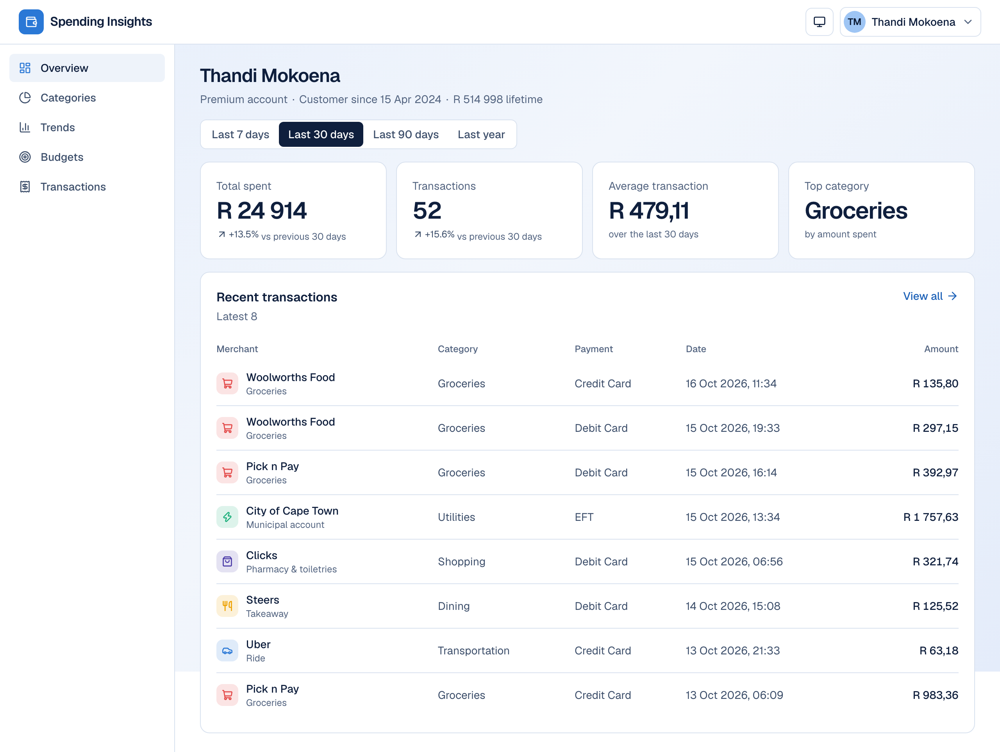
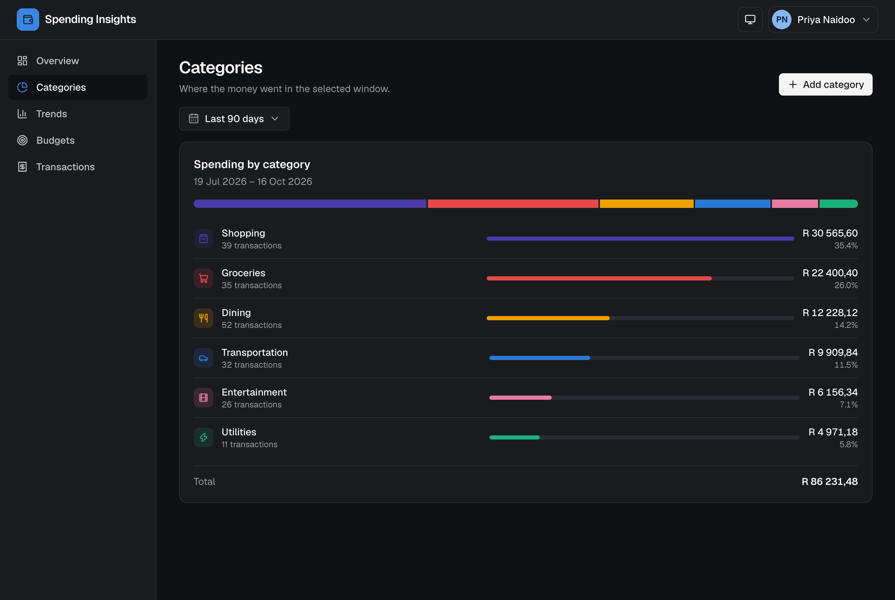

# Customer Spending Insights

A responsive financial analytics dashboard showing a customer's spending, backed by an API that
serves realistic mocked transaction history.



<details>
<summary>Categories page in the dark theme</summary>



</details>

| Part | Stack | Folder |
|------|-------|--------|
| API | Python 3.11, FastAPI, Pydantic v2, pytest, ruff | [`customer-api/`](customer-api/) |
| Dashboard | Next.js 16 (App Router, server-rendered), React 19, TanStack Query, TypeScript, Tailwind v4, Radix, Recharts, Storybook, Vitest | [`customer-client/`](customer-client/) |

## Quick start (Docker)

```sh
docker compose up --build
```

- Dashboard: http://localhost:3000
- API docs (Swagger UI): http://localhost:8000/docs

If a port is already taken, `scripts/dev.sh` frees 3000, 8000 and 6006 (stopping the stack, then
killing whatever else listens there) and brings the stack back up; `scripts/dev.sh --down` only
frees the ports.

Both containers bind-mount the source, so edits hot-reload. Set `MOCK_TODAY=2024-09-16` in the
environment to pin the dataset's reference date (see below).

## Running without Docker

Prerequisites: Python 3.11+ with [Poetry](https://python-poetry.org/), Node 22+.

```sh
# API
cd customer-api
poetry install
poetry run fastapi dev src/customer_api/main.py        # http://localhost:8000

# Dashboard (in another terminal)
cd customer-client
npm ci
npm run dev                                            # http://localhost:3000
```

The dashboard reads the API base URL from `NEXT_PUBLIC_API_URL` (default `http://localhost:8000`).

## Testing

```sh
cd customer-api   && poetry run pytest && poetry run ruff check . && poetry run ruff format --check .
cd customer-client && npm test && npm run lint && npm run typecheck
```

- API: unit tests for the analytics functions and contract tests for every endpoint against the
  seeded dataset with a pinned date.
- Client: unit tests for formatting, the API client (mocked `fetch`), the data-fetching hook, and a
  component test.

## Production builds

```sh
# API image (non-root, no reload)
docker build -t customer-api --target prod customer-api

# Dashboard: standalone Next server (see customer-client/README.md for the Lambda image)
docker build -t customer-client --target prod --build-arg NEXT_PUBLIC_API_URL=https://api.example.com customer-client
```

The API also ships an AWS Lambda entrypoint and SAM template; see [customer-api/README.md](customer-api/README.md).

## How it works

### API

`GET /api/customers` lists the mock customers; every other endpoint is scoped to one customer:

| Endpoint | Purpose |
|----------|---------|
| `/api/customers/{id}/profile` | Name, account type, join date, lifetime spend |
| `/api/customers/{id}/spending/summary?period=` | Total, count, average, top category, change vs the previous period |
| `/api/customers/{id}/spending/categories?period=&startDate=&endDate=` | Spend per category with share, colour and icon |
| `/api/customers/{id}/spending/trends?months=` | Monthly totals, zero-filled, oldest first |
| `/api/customers/{id}/transactions?limit=&offset=&category=&startDate=&endDate=&sortBy=` | Paginated, filterable, sortable transactions |
| `POST /api/customers/{id}/transactions` | Records a transaction in memory (merchant, category, amount, date, description, payment method); 201 with the created record |
| `/api/customers/{id}/goals` | Month-to-date spend against monthly budgets |
| `POST /api/customers/{id}/goals` | Sets a monthly budget for one of the customer's categories; 409 if that category already has one |
| `/api/customers/{id}/filters` | The customer's categories, period presets, payment methods, and the icon and colour choices for new categories |
| `POST /api/customers/{id}/categories` | Adds a category (name, hex colour, icon) to that customer; 409 on a duplicate name |

Categories are per customer: six defaults plus any the customer adds. `period` is one of `7d`,
`30d`, `90d`, `1y`, ending today. Unknown customers return 404; bad
parameters (unknown category, inverted date range, limit > 100) return 422 with a message.

The code is layered so the mock store can be swapped for a database without touching the endpoints:

- `domain.py`: enums and dataclasses. Money is integer cents so aggregation is exact.
- `mock_data.py`: a seeded generator that builds 24 months of history for six personas from
  South African merchants, with monthly subscriptions, seasonal spikes, and budgets derived from
  each persona's own spend so some goals are met and others blown.
- `repository.py`: the `CustomerRepository` protocol and its in-memory implementation.
- `services.py`: pure analytics functions (rolling windows, comparisons, trends, goal progress).
- `routes.py` / `schemas.py`: FastAPI endpoints and camelCase response models.

### Dashboard

One route per concern under `/customers/{id}`: overview with recent transactions, categories,
trends, budgets and the full transaction list. Routes are server components that prefetch their
data into TanStack Query and hydrate the client, so the first HTML already carries the numbers;
after that the client cache makes navigation instant and keeps previous data on screen while a
change loads. View state (customer, period, date range, months) lives in the URL. The UI is built
from small presentational components catalogued in Storybook, with Radix primitives for keyboard
and focus behaviour, four themes, and an axe suite in the tests.

## Design notes

- **Mocked data is generated, not hard-coded.** The brief asks for mocked data; a seeded generator
  gives thousands of coherent transactions, realistic period-over-period comparisons, and data that
  always ends "today". `MOCK_SEED` and `MOCK_TODAY` make it reproducible.
- **Category colours** were re-chosen from the original draft palette after a colour-vision check:
  the draft had two near-identical blues and a yellow that failed contrast. The UI pairs every
  colour with an icon and a text label so no information depends on hue alone.
- **Not done (deliberately, for scope):** authentication, a real database, and end-to-end browser
  tests.
